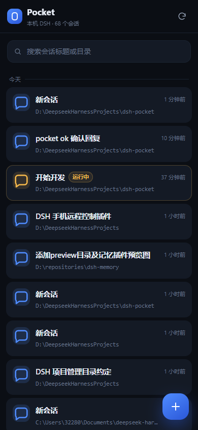
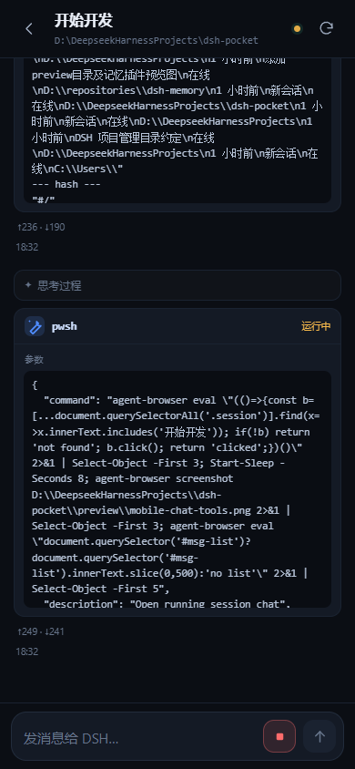
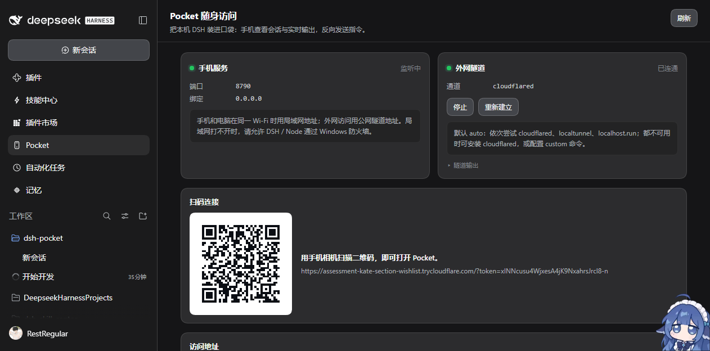

# dsh-pocket

把本机的 DeepSeek Harness 装进口袋：起一个独立的移动端 Web 服务，按需拉起内外网隧道；手机浏览器打开后可以查看会话、实时输出和工具调用，也能反向发送指令、停止当前回合。

- **独立移动页面**：不是把桌面 GUI 硬塞进手机，而是为窄屏重写的会话列表 + 聊天流。
- **与桌面一致的工作区视图**：按 `workspaceController` 的工作区顺序和会话归属分组；默认隐藏已归档会话，顶部一键切换显示。
- **流式输出**：WebSocket 跟进 `sessionController.follow`，助手文本、思考过程、工具调用与结果实时出现。历史快照分批推送，手机边收边渲染。
- **反向控制**：发送提示词、停止当前回合、新建会话（自动挂到对应工作区）。
- **繁忙发送**：手机发送时读取桌面 `ui-conversation.busyEnter` 设置；空闲时正常发送，运行中按设置选择「排队发送」或「插话发送」。
- **会话设置**：手机里切换模型与思考等级、选择权限预置、插入 `/技能` 引用；设置入口在输入框上方的滑杆按钮。
- **图片消息**：从相册选择最多 4 张图片随消息发送；Markdown 图片和表格可在聊天流里正常渲染。
- **提问与审批**：手机在线时接管 `user-questions/request` 与 `approval/request` waterfall；前台阻塞提问可直接作答，工具审批可选择「允许一次 / 拒绝」。continued 提问仍从投影显示。手机离线时自动回落到桌面 answerer。
- **多种隧道**：`cloudflared`（Quick Tunnel，无浏览器拦截页）、`localtunnel`、`localhost.run`，或 **自有服务器 SSH 反向转发**（服务器只需 Node.js，无需改 sshd）；也可以填自定义命令或固定的 `publicUrl`。
- **扫码即用**：桌面面板生成带令牌的二维码，手机相机一扫就打开。
- **令牌保护**：128 位随机访问令牌；支持 Cookie / URL / 请求头三种携带方式，面板可一键轮换。
- **轻量依赖**：一个 `ws`（WebSocket 服务端），二维码编码器随包内嵌；宿主和移动页面其余部分都是原生 ESM。

| 会话列表 | 聊天与工具卡片 | 桌面面板 |
| --- | --- | --- |
|  |  |  |

> 截图里的访问令牌已经轮换失效；实际令牌以你本机面板显示的二维码为准。

## 安装

在当前 DSH profile 里安装本目录（Plugin Manager → 本地目录安装，或调用 `plugin_manager` 的 `install_bundle`）：

```text
D:\DeepseekHarnessProjects\dsh-pocket
```

装好后刷新一次 Web GUI，侧栏的全局面板列表里会出现 **Pocket**。

> 本包以 `link:` 方式安装到 profile 时，pnpm 不会替被链接的目录安装它自己的可选依赖。若要让 Windows x64 自动带上 cloudflared，请先在本目录执行一次 `pnpm install`（只影响本目录的 `node_modules`）。从 npm 正式安装时这一步由包管理器自动完成。

## 配置

插件行 id 为 `dsh-pocket`，默认配置见 [`cordis.patch.yml`](cordis.patch.yml)。

| 字段 | 默认 | 说明 |
| --- | --- | --- |
| `port` | `8790` | 移动端监听端口；被占用时自动向后找 10 个端口。`0` 表示随机端口。 |
| `lan` | `false`（本仓库 patch 里为 `true`） | 是否绑定 `0.0.0.0` 允许局域网访问；关掉时只绑 `127.0.0.1`，但隧道仍可用。 |
| `tunnel` | `auto` | `auto` / `cloudflared` / `localtunnel` / `localhost.run` / `ssh` / `custom` / `off`。 |
| `autoStart` | `true` | Host 启动后是否自动拉起隧道。 |
| `publicUrl` | 无 | 已有反向代理或固定域名时直接使用它，不再起隧道进程。 |
| `cloudflaredPath` | 无 | 指定 cloudflared 可执行文件；留空时优先用随包二进制，其次 PATH。 |
| `customCommand` | 无 | `tunnel: custom` 时执行；`%PORT%` 会被替换成本地端口，输出里第一个公网 URL 视为就绪。 |
| `sshHost` | 无 | 自有服务器地址；设置后可将 `tunnel` 设为 `ssh`。 |
| `sshUser` | `root` | SSH 用户名；请使用免密公钥登录。 |
| `sshPort` | `22` | SSH 端口。 |
| `sshKeyPath` | 无 | SSH 私钥路径；支持 `~/...`。 |
| `sshRemotePort` | `8790` | SSH 在服务器 `127.0.0.1` 上绑定的反向转发端口。 |
| `sshExposePort` | `80` | 服务器上 Node TCP 代理监听的公网端口；需在防火墙/安全组放行。 |
| `sshExposeHost` | `0.0.0.0` | 服务器 TCP 代理绑定地址；若用 Nginx/Caddy 反代可设为 `127.0.0.1`。 |
| `sshPublicUrl` | 无 | 自有域名/HTTPS 入口；设置后二维码使用它，而不是 `http://<sshHost>:<sshExposePort>`。 |
| `token` | 自动生成 | 固定访问令牌；留空时使用 `~/.dsh/pocket/state.json` 里持久化的令牌。 |

### 用自有服务器转发

`tunnel: ssh` 不要求服务器开启 `GatewayPorts`，也不改 `sshd`：

1. SSH 建立 `-R 127.0.0.1:sshRemotePort:127.0.0.1:<本地端口>`。
2. SSH 在服务器上启动一个很小的 Node TCP 代理，监听 `sshExposeHost:sshExposePort`，转发到 `127.0.0.1:sshRemotePort`。
3. 手机访问 `sshPublicUrl`，未设置时访问 `http://<sshHost>[:sshExposePort]`。

示例：

```yaml
tunnel: ssh
sshHost: 106.55.38.48
sshUser: root
sshKeyPath: ~/.ssh/id_ed25519
sshPort: 22
sshRemotePort: 8790
sshExposePort: 80
# 可选：有域名/HTTPS 反代时填写
# sshPublicUrl: https://pocket.example.com
```

也可以完全不动 YAML：桌面 Pocket 面板的「公网入口」选「自有服务器」，填 IP/域名，点「切换」。切换会重启隧道并更新二维码；再选「Cloudflared（默认）」即可切回。

要求：服务器能免密 SSH 登录且装有 Node.js；`sshExposePort` 在服务器防火墙和云安全组中放行。

> 直接监听公网 80 时是 **HTTP**，令牌和会话内容会以明文经过网络。生产使用建议让 `sshExposeHost: 127.0.0.1`，再在服务器上用 Nginx/Caddy 做 HTTPS 反代，并把 `sshPublicUrl` 指到 HTTPS 地址。

状态文件保存访问令牌和面板里选择的公网入口：`$DSH_HOME/pocket/state.json`（默认 `~/.dsh/pocket/state.json`）。端口、隧道地址每次启动重新协商。

桌面 **Pocket** 面板的「公网入口」可以在 **Cloudflared（默认）** 和 **自有服务器** 之间切换；填入服务器 IP/域名后点「切换」即可，选择会写入状态文件，DSH 重启后保留。

## 从手机访问

1. 打开桌面侧栏的 **Pocket**。
2. 手机相机扫描「扫码连接」里的二维码；隧道在线时二维码指向公网地址，否则指向局域网地址。
3. 首次打开会写入一个 30 天有效的 HttpOnly Cookie；也可以把地址收藏。

也可以手动复制面板里的「本机 / 局域网 / 公网」地址。**链接里带有访问令牌，等同于本机 DSH 的钥匙**，不要发到公开群聊或截图分享。令牌被泄露时，在面板点「轮换令牌」。

### 隧道选择

- **cloudflared**（推荐）：Quick Tunnel 无需账号，没有浏览器拦截页。Windows x64 上会通过可选依赖 `agentroam-cloudflared-win32-x64` 使用经过校验的官方二进制；其他平台请把 `cloudflared` 放进 PATH 或设置 `cloudflaredPath`。
- **localtunnel**：需要系统里有 `lt` 命令。浏览器首次访问会经过 localtunnel 的 511 提示页，需要输入本机公网 IP 作为 tunnel password。
- **localhost.run**：通过 `ssh -R` 建立隧道，需要出站 22 端口可用。
- **custom**：任何能在 stdout/stderr 打印公网 URL 的命令都行，例如自建 frp / rathole 的客户端。

`auto` 会按 `cloudflared → localtunnel → localhost.run` 的顺序尝试，失败原因会显示在面板的「隧道输出」里。

> 部分网络（例如只返回 AAAA 记录的 DNS）可能让 `*.trycloudflare.com` 在电脑本机解析失败，但手机走自己的 DNS 通常正常。若手机也打不开，改用局域网地址或切换隧道方式。

## 移动端能力

- 会话列表：按工作区分组（顺序与桌面侧栏一致）、标题、运行状态、最新活动时间；工作区可折叠/展开并记住状态；每个工作区标题右侧的 `+` 直接在对应目录新建会话；空会话（点过新建但没发消息）不显示；顶部按钮切换是否显示已归档会话；搜索会话/工作区/目录。
- 聊天流：用户/助手消息、Markdown（标题、列表、代码块、表格、图片）、思考过程折叠、工具调用参数与结果、token 用量。Markdown 里的相对图片路径按当前会话工作区解析。
- 工具卡片：默认折叠，标题里显示自动截断的命令/路径/查询摘要；点开看完整参数与结果，展开状态在流式重绘时保持。
- 输入框：`Enter` 发送、`Shift+Enter` 换行；运行中显示停止按钮，发送会进入 DSH 的队列。
- 新建会话：直接点工作区标题右侧的 `+`，新会话自动挂到该工作区。
- 历史翻页：顶部「加载更早的消息」。

## HTTP 接口

移动服务（默认 `8790`）除 `/healthz` 外都需要令牌：

| 方法 | 路径 | 说明 |
| --- | --- | --- |
| GET | `/` | 移动页面（无令牌时显示解锁页）。 |
| GET | `/api/sessions` | 会话列表，同时返回 `workspaces` / `unassigned` / `archived` / `pinned` 分组。 |
| POST | `/api/sessions` | 新建会话，`{ "cwd": "..." }`。 |
| GET | `/api/sessions/:id` | 标题、目录、运行状态。 |
| WS | `/ws/session/:id?token=...` | 手机端使用的会话流：`hello`、`snapshot-meta` / `snapshot-batch` / `snapshot-end`、`frame`；以及 `question-request` / `approval-request` / `interaction-closed` 前台交互。 |
| GET | `/api/sessions/:id/follow` | SSE 版本，保留给 curl/调试；注意部分隧道会缓冲 SSE 响应。 |
| GET | `/api/sessions/:id/page?throughSeq=&beforeSeq=` | 历史翻页。 |
| POST | `/api/sessions/:id/prompt` | `{ "text": "...", "mode": "auto" \| "queue" \| "steer", "images": [{ "mediaType", "data", "name" }] }`；`auto` 在运行中读取桌面 `busyEnter`。 |
| POST | `/api/sessions/:id/cancel` | 停止当前回合。 |
| GET | `/api/sessions/:id/controls` | 模型目录/当前选择、权限目录/当前预设、用户可见技能。 |
| POST | `/api/sessions/:id/model` | `{ "provider", "model", "reasoningEffort" }`。 |
| POST | `/api/sessions/:id/permissions` | `{ "preset": "..." }`。 |
| GET | `/api/sessions/:id/questions` | `userQuestions` 投影的 active/settled 提问。 |
| POST | `/api/sessions/:id/questions/:callId/answer` | `{ "answers": [{ "id", "selected", "custom" }] }`，回答 continued 提问。 |
| POST | `/api/sessions/:id/interactions/:requestId/answer` | 回答前台阻塞提问（`answers`）或审批（`outcome: "allowed-once" \| "rejected"`）。 |
| GET | `/api/sessions/:id/attachments/:attachmentId` | 读取会话图片附件。 |
| GET | `/api/sessions/:id/file?path=preview/x.png` | 读取会话工作区内的图片，供 Markdown 相对路径图片使用。 |

桌面面板路由只接受回环请求：`GET /dsh-pocket?op=status`，`POST /dsh-pocket` 支持 `tunnel-start`、`tunnel-stop`、`tunnel-restart`、`rotate-token`、`restart`。

模型工具 `pocket_share` 会把当前手机入口地址交给模型，方便用户直接要链接。

## 已知限制

- **多端同时在线**：手机与桌面都能回答同一个提问/审批，先提交的一方生效；手机没有该会话的 WebSocket 时自动回落到桌面 answerer。
- **图片输入**：需要当前模型声明支持图片输入；手机端最多 4 张、单张 18 MB。
- **子代理会话**：移动列表只列普通会话，子代理（`origin: subagent`）不单独展示。
- **置顶**：置顶会话会在工作区内排到最前并显示标记，但没有单独的「置顶」分组。
- **PWA 离线**：有 manifest，但没有 Service Worker 离线缓存。

## 开发

```powershell
node --check lib\index.js
node --check lib\server.js
node --check lib\tunnel.js
node --check web\app.js
node --check client\client.js
pnpm install   # 拉取 ws，以及 Windows x64 的可选 cloudflared 二进制
```

- 宿主：`lib/index.js` 负责配置、生命周期与桌面面板路由；`lib/server.js` 是移动 HTTP/WS 服务；`lib/tunnel.js` 管理隧道子进程。
- 移动页面：`web/`（原生 ESM，无构建）。
- 桌面面板：`client/client.js`，注册 `sidebar.panellist` 与 `main` 两个 slot。

### 为什么用 WebSocket 而不是 SSE

Cloudflare Quick Tunnel 会缓冲小的 SSE 响应：手机打开会话时历史快照迟迟不落地，直到用户发送一条消息把缓冲区推过阈值，历史才突然出现。把历史拆成 `snapshot-meta` / `snapshot-batch` / `snapshot-end` 并改走 WebSocket 后，快照和实时帧都能立即到达；`/api/sessions/:id/follow` 的 SSE 版本仍保留给 curl 调试。

### 一个踩过的坑

宿主会把多个 Client 插件拼进同一个 `<script>` 批次。各插件 bundle 的顶层 `const` 共享全局词法作用域——本插件最初在顶层声明了 `const MODULE_ID`，与 `@restregular/dsh-skill-center` 撞名，导致整条 web boot 报 `Identifier 'MODULE_ID' has already been declared`。现在整个 `client/client.js` 包在 IIFE 里；新增 Client 插件时也应该这样做。

## License

MIT。随包内嵌的二维码编码器与 cloudflared 二进制的许可见 [THIRD_PARTY_NOTICES.md](THIRD_PARTY_NOTICES.md)。
