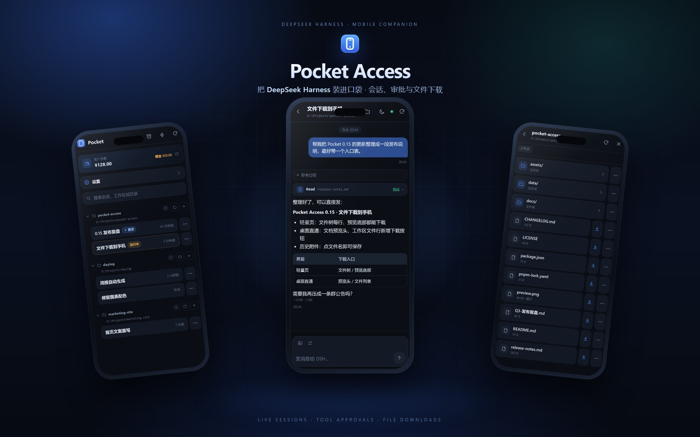
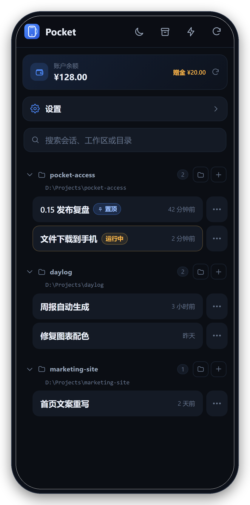
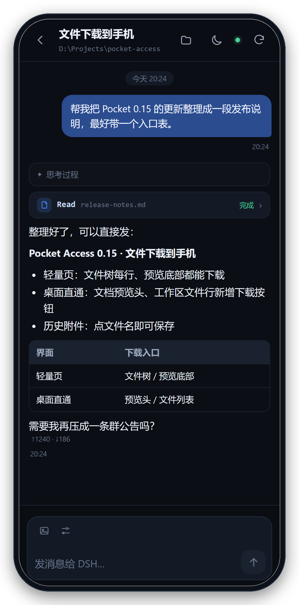
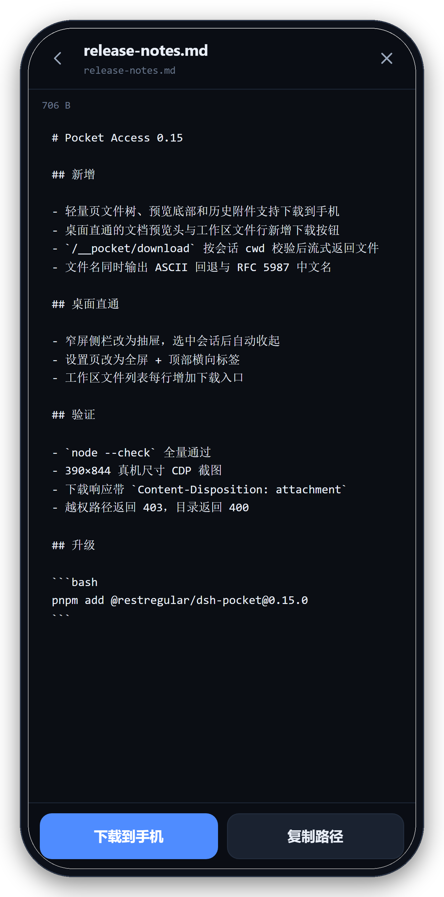
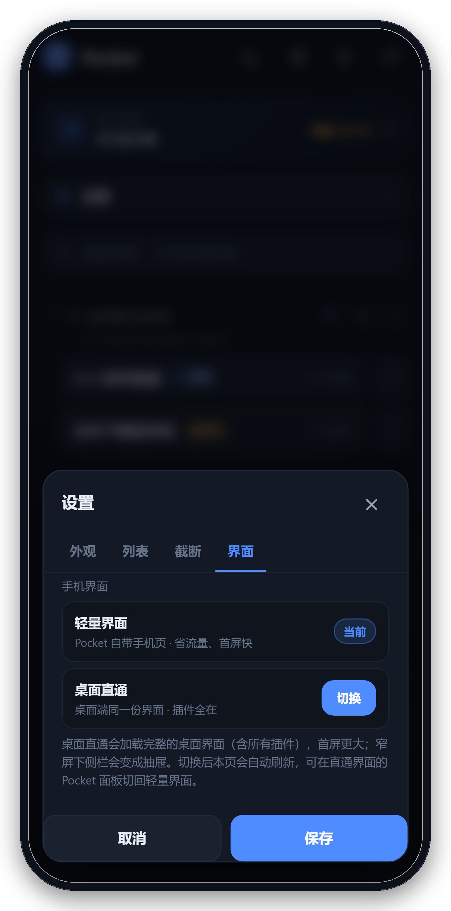
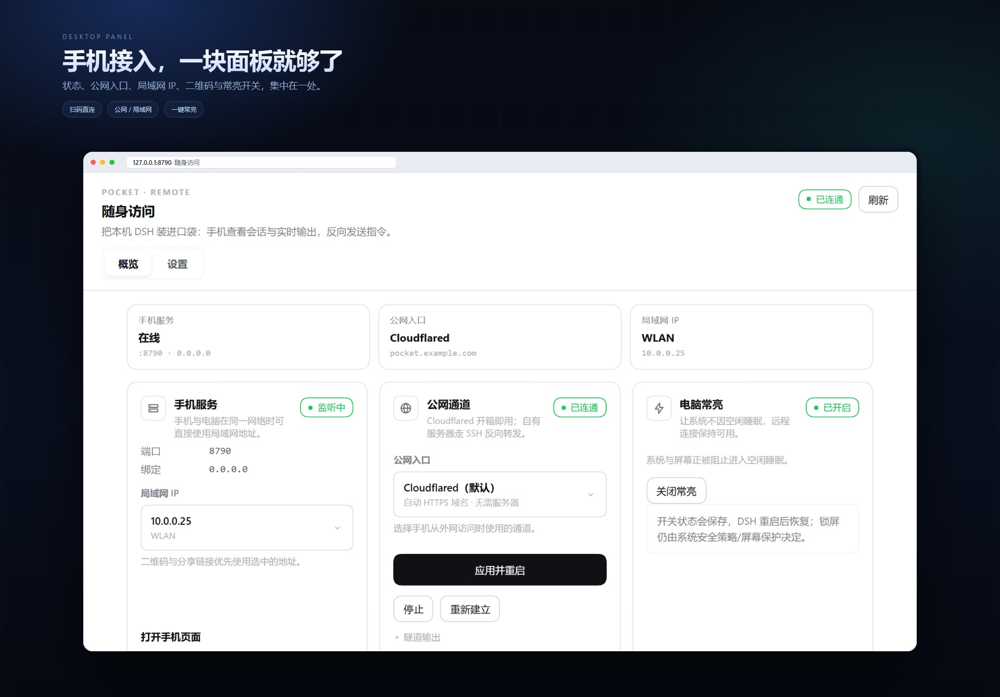

<div align="center">


<h1>Pocket Access · dsh-pocket</h1>

<p><strong>把本机的 DeepSeek Harness 装进口袋。</strong></p>

<p>在手机上继续会话、盯住流式输出、回答问题与审批、下载产物。<br />
轻量界面为小屏重写；需要完整桌面能力时，一键直通宿主 Web GUI。</p>

<p>
  <a href="https://www.npmjs.com/package/@restregular/dsh-pocket"></a>
  <a href="https://www.npmjs.com/package/@restregular/dsh-pocket"></a>
  = 22.13" />
  <a href="LICENSE"></a>
  
</p>

</div>

> **Pocket Access** 是 DeepSeek Harness 的移动端伴侣插件。插件列表与侧栏的显示名为 **随身访问**；包名为 `@restregular/dsh-pocket`。
>
> **English** — A mobile companion for DeepSeek Harness. It serves a purpose-built phone UI and can reverse-proxy the full desktop GUI, with live sessions, prompts, tool approvals, file downloads, LAN/tunnel access, and one-tap keep-awake.

<p align="center">
  
</p>

## 目录

- [为什么是 Pocket](#为什么是-pocket)
- [功能一览](#功能一览)
- [两种界面，按场景选择](#两种界面按场景选择)
- [界面预览](#界面预览)
- [快速开始](#快速开始)
- [安装](#安装)
- [从手机访问](#从手机访问)
- [远程访问](#远程访问)
- [移动端能力](#移动端能力)
- [桌面 Pocket 面板](#桌面-pocket-面板)
- [安全模型](#安全模型)
- [配置](#配置)
- [HTTP 接口](#http-接口)
- [已知限制](#已知限制)
- [开发](#开发)
- [反馈与贡献](#反馈与贡献)
- [License](#license)

## 为什么是 Pocket

DeepSeek Harness 的 Web GUI 为桌面设计。Pocket 不要求你在手机上重新适应一套缩水界面，也不要求插件作者为移动端再写一遍 UI；它提供两条互补的路径：

- **两种界面，同一套能力。** 默认的轻量页为窄屏重写会话流与输入流程，首屏小、打开快；需要终端、插件市场、文件预览或任何第三方插件面板时，一键切到「桌面直通」，手机加载的就是桌面端同一份渲染代码。
- **不只是看，而是接管。** 发送提示词、停止回合、切换模型与思考等级、选择权限预设、处理阻塞式提问和工具审批，全部可以在手机上完成；手机离线时自动回落到桌面。
- **为真实网络设计。** 局域网直连、Cloudflare Quick Tunnel、localtunnel、localhost.run、自有服务器 SSH 反向转发，或自定义命令；桌面面板生成带令牌的二维码，扫一下就进入。
- **手机端细节不是事后补的。** 发图前本地压缩、工作区文件直接下载到手机、跨会话提问提醒、跟随系统主题、主屏幕图标、保持电脑常亮——都按移动端使用习惯处理。
- **边界清晰的安全模型。** 128 位随机令牌；桌面面板只接受回环请求；文件读取限制在会话 cwd 或已登记工作区；GUI Cookie 留在 Pocket 内部，不交给手机。
- **轻量、无构建。** 移动页面是原生 ESM，唯一的运行时依赖是 `ws`；二维码编码器随包内嵌，不需要前端构建链。

## 功能一览

| 类别 | 能力 |
| --- | --- |
| 会话 | 按桌面工作区顺序分组、折叠、搜索、新建、置顶、重命名、归档/取消归档、复制 Session ID |
| 实时对话 | WebSocket 流式输出、历史快照分批到达、思考过程折叠、工具调用参数与结果、token 用量 |
| 远程控制 | 发送 / 排队 / 插话、停止回合、模型与思考等级、权限预设、`/技能` 引用 |
| 人机交互 | 阻塞式提问直接作答、工具审批「允许一次 / 拒绝」、跨会话提醒、手机回答后撤回桌面弹窗 |
| 文件与媒体 | 工作区文件树、文本/图片预览、`@路径` 引用、文件下载到手机、最多 4 张图片消息与本地压缩 |
| 外观与体验 | 跟随系统 / 浅色 / 深色、历史截断设置、回到底部、PWA 主屏幕图标 |
| 宿主能力 | 账户余额、保持电脑常亮、桌面 Pocket 面板、扫码连接、令牌轮换 |
| 远程访问 | 局域网、Cloudflare、localtunnel、localhost.run、自有服务器 SSH、自定义隧道、固定 `publicUrl` |

## 两种界面，按场景选择

Pocket 的核心差异是：**手机界面不是桌面界面的降级版，而是一个可切换的完整方案。**

| | 轻量界面（默认） | 桌面直通 |
| --- | --- | --- |
| 首屏 | 为小屏重写的会话列表与聊天流，加载快 | 完整的桌面 bundle（含全部插件） |
| 插件 UI | 重写核心会话、文件、审批流程 | 插件面板、设置、终端、市场原样复用 |
| 适合 | 日常查看、回复、审批、下载产物 | 需要桌面专属功能或第三方插件界面 |
| 代价 | 新插件不会自动出现在轻量页 | 首屏更大；触摸交互不如原生移动页顺手 |
| 切换 | 手机设置 →「界面」；或桌面 Pocket 面板 →「设置 → 手机端界面」 | 同上，也可访问 `GET /__pocket/surface?to=desktop` |

桌面直通不是简单的 iframe：Pocket 把宿主 Web GUI 整页反向代理给手机，并处理两层认证——手机仍先过 Pocket 令牌/Cookie，Pocket 再用进程启动令牌换取绑定回环 authority 的 GUI Cookie。隧道地址变化不影响使用。

## 界面预览

<table align="center">
  <tr>
    <td align="center" width="50%">
      <br />
      <sub><b>会话列表</b> · 工作区分组、搜索、置顶与归档</sub>
    </td>
    <td align="center" width="50%">
      <br />
      <sub><b>实时对话</b> · 流式输出、思考过程、工具卡片与 Markdown 表格</sub>
    </td>
  </tr>
  <tr>
    <td align="center" width="50%">
      <br />
      <sub><b>文件下载</b> · 预览底部、文件树每行都能直接保存到手机</sub>
    </td>
    <td align="center" width="50%">
      <br />
      <sub><b>界面切换</b> · 轻量界面与桌面直通，按场景选择</sub>
    </td>
  </tr>
</table>

> 截图使用演示会话、演示余额与演示地址；二维码和令牌均为示例，真实值以你本机面板显示为准。

## 快速开始

1. **安装插件**：在 Plugin Manager 中安装 `@restregular/dsh-pocket`，或使用本地目录安装。
2. **打开面板**：刷新一次 Web GUI，在侧栏的全局面板列表里打开 **随身访问 / Pocket Access**。
3. **扫码进入**：手机相机扫描面板里的二维码；隧道在线时指向公网地址，否则指向局域网地址。首次打开会写入一个 30 天有效的 HttpOnly Cookie。

装好后建议把手机页面「添加到主屏幕」；iOS 使用 180/192 PNG 图标，避免 SVG 在主屏幕上显示空白。

## 安装

从 npm 安装（Plugin Manager →「安装 Bundle」，或调用 `plugin_manager` 的 `install_bundle`）：

```text
@restregular/dsh-pocket
```

也可以安装本目录（Plugin Manager →「本地目录安装」）：

```text
D:\DeepseekHarnessProjects\dsh-pocket
```

> 本包以 `link:` 方式安装到 profile 时，pnpm 不会替被链接的目录安装它自己的可选依赖。若要让 Windows x64 自动带上 cloudflared，请先在本目录执行一次 `pnpm install`（只影响本目录的 `node_modules`）。从 npm 正式安装时这一步由包管理器自动完成。

## 从手机访问

1. 打开桌面侧栏的 **随身访问 / Pocket Access**。
2. 手机相机扫描「扫码连接」里的二维码。
3. 首次打开会种下 30 天有效的 HttpOnly Cookie；也可以直接收藏地址。

也可以手动复制面板里的「本机 / 局域网 / 公网」地址。

> **链接里带有访问令牌，等同于本机 DSH 的钥匙。** 不要发到公开群聊或截图分享。令牌泄露时，在面板点「轮换令牌」；旧链接会立即失效。

## 远程访问

### 隧道怎么选

| 方式 | 适合 | 说明 |
| --- | --- | --- |
| `cloudflared`（推荐） | 大多数场景 | Quick Tunnel 无需账号，没有浏览器拦截页。Windows x64 会通过可选依赖 `agentroam-cloudflared-win32-x64` 使用经过校验的官方二进制；其他平台把 `cloudflared` 放进 PATH，或设置 `cloudflaredPath`。 |
| `localtunnel` | 已有 `lt` 命令 | 浏览器首次访问会经过 localtunnel 的 511 提示页，需要输入本机公网 IP 作为 tunnel password。 |
| `localhost.run` | 出站 22 端口可用 | 通过 `ssh -R` 建立隧道，不需要额外客户端。 |
| `ssh` | 有自有服务器 | 不要求服务器开启 `GatewayPorts`，也不改 `sshd`；见下一节。 |
| `custom` | 已有 frp / rathole 等 | 任何能在 stdout/stderr 打印公网 URL 的命令都行，`%PORT%` 会替换成本地端口。 |
| `publicUrl` | 已有反向代理/固定域名 | 直接使用固定地址，不再起隧道进程。 |

`auto` 会按 `cloudflared → localtunnel → localhost.run` 的顺序尝试；失败原因会显示在面板的「隧道输出」里。

> 部分网络（例如只返回 AAAA 记录的 DNS）可能让 `*.trycloudflare.com` 在电脑本机解析失败，但手机走自己的 DNS 通常正常。若手机也打不开，改用局域网地址或切换隧道方式。

### 自有服务器转发

`tunnel: ssh` 只要求服务器能免密 SSH 登录并装有 Node.js：

1. 本地 SSH 建立 `-R 127.0.0.1:sshRemotePort:127.0.0.1:<本地端口>`。
2. SSH 在服务器上启动一个很小的 Node TCP 代理，监听 `sshExposeHost:sshExposePort`，转发到 `127.0.0.1:sshRemotePort`。
3. 手机访问 `sshPublicUrl`；未设置时访问 `http://<sshHost>[:sshExposePort]`。

```yaml
tunnel: ssh
sshHost: 203.0.113.10
sshUser: root
sshKeyPath: ~/.ssh/id_ed25519
sshPort: 22
sshRemotePort: 8790
sshExposePort: 80
# 可选：有域名/HTTPS 反代时填写
# sshPublicUrl: https://pocket.example.com
```

也可以完全不动 YAML：桌面 Pocket 面板的「公网入口」选「自有服务器」，填 IP/域名，点「切换」。切换会重启隧道并更新二维码；再选「Cloudflared（默认）」即可切回。

要求：`sshExposePort` 在服务器防火墙和云安全组中放行。

> 直接监听公网 80 时是 **HTTP**，令牌和会话内容会以明文经过网络。生产使用建议让 `sshExposeHost: 127.0.0.1`，在服务器上用 Nginx/Caddy 做 HTTPS 反代，并把 `sshPublicUrl` 指到 HTTPS 地址。

状态文件保存访问令牌、创建时间、面板选中的局域网 IP、公网入口和「保持电脑常亮」开关：`$DSH_HOME/pocket/state.json`（默认 `~/.dsh/pocket/state.json`）。端口、隧道地址每次启动重新协商。

## 移动端能力

### 会话与聊天

- **会话列表**：按 `workspaceController` 的工作区顺序和会话归属分组；工作区可折叠/展开并记住状态；标题右侧的 `+` 直接在对应目录新建会话；空会话（点过新建但没发消息）不显示；顶部按钮切换是否显示已归档会话；支持搜索会话、工作区和目录。
- **会话操作**：置顶/取消置顶（只在所属工作区内排到最前）、重命名、归档/取消归档、复制 Session ID。归档运行中的会话会先确认；Host 拒绝时再提供「停止并归档」。
- **聊天流**：用户/助手消息、Markdown（标题、列表、代码块、表格、图片）、思考过程折叠、工具调用参数与结果、token 用量。Markdown 里的相对图片路径按当前会话工作区解析。
- **阅读位置**：往上翻历史时，输入框上方出现「回到底部」；流式输出期间向上滚动会暂停重绘和自动吸底。展开的思考/工具卡片在重绘后保持展开。
- **工具卡片**：默认折叠，标题显示自动截断的命令/路径/查询摘要；点开看完整参数与结果。
- **历史翻页**：顶部「加载更早的消息」。

### 输入与会话设置

- **输入框**：`Enter` 发送、`Shift+Enter` 换行；运行中显示停止按钮；发送时跟随桌面的 `ui-conversation.busyEnter` 选择排队或插话。
- **会话设置**：输入框上方的滑杆按钮，切换模型与思考等级、选择权限预设、插入 `/技能` 引用。
- **手机设置**：首页余额下方的「设置」入口（会话设置里也有同名入口），标签页分为「外观 / 列表 / 截断 / 界面」：
  - 外观：跟随系统 / 浅色 / 深色，与顶栏主题按钮同步；
  - 列表：是否显示已归档会话，与顶栏归档按钮同步；
  - 截断：分别关闭「工具输出」「Agent 回复」「思考过程」的截断，并设置 500–50000 字符的截断长度（默认 6000）。设置保存在 Host，手机和桌面共用；
  - 界面：显示当前「轻量界面」，可一键切换到「桌面直通」，切换后页面自动刷新。

### 文件与媒体

- **文件树**：首页工作区标题右侧的文件夹按钮，或会话顶栏的文件夹按钮，打开手机端文件浏览器；目录按层加载，面包屑可回退。
- **预览**：文本/代码直接预览（最大 400 KB，超出截断），图片直接显示；可复制相对路径或完整路径；会话内还能把文件作为 `@路径` 引用插入输入框（含空格的路径自动写成 `@"..."`，目录带尾斜杠）。
- **下载到手机**：文件树每个文件行、文件预览底部、历史消息里的文件附件都能直接下载。下载由 Pocket 校验会话 cwd 后以附件流式返回，带 RFC 5987 中文文件名；不需要把桌面 GUI 暴露成文件服务器。
- **图片消息**：从相册选择最多 4 张图片；发送前在手机本地压到长边 2048px、单张约 ≤1.5 MB（HEIC/HEIF/AVIF 也会转成 JPEG）。支持 png/jpeg/webp/gif/heic/heif/avif；单张原图上限 18 MB、压缩后 6 MB、总计 15 MB。

### 提醒与状态

- **提问与审批**：手机在线时接管 `user-questions/request` 与 `approval/request` waterfall；前台阻塞提问可直接作答，工具审批可选择「允许一次 / 拒绝」。手机切到任意会话时，WebSocket 会补发该会话仍在等待的提问/审批；手机作答后桌面端残留的弹窗会同步撤掉。continued 提问仍从投影显示。手机离线时自动回落到桌面 answerer。
- **跨会话提醒**：别的会话被提问或审批阻塞时，手机页面顶部会弹出提示（显示会话标题与工具名/问题摘要），点一下直接切到对应会话；在会话页里只提示「其他会话」，当前会话仍用输入框上方的问答条处理。提示会随桌面/手机的回答自动消失，也可以手动忽略。
- **账户余额**：首页顶部显示平台账户余额与赠金，点卡片可立即刷新；Host 缓存 60 秒。未登录、API Key 模式或查询失败时不显示。
- **保持常亮**：桌面面板和手机顶栏的一键开关，阻止系统与屏幕因空闲休眠。Windows 走 `SetThreadExecutionState`，macOS 用 `caffeinate`，Linux 用 `systemd-inhibit`；选择持久化，DSH 退出即释放。

### 桌面直通细节

桌面端和 `dsh web` 的页面本来就是同一份渲染代码（`@deepseek-ai/dsh-web-frontend` + 宿主注入的插件 client bundle）。打开桌面直通后：

- 手机看到的是桌面界面本身：插件面板、设置、终端、文件预览、插件市场全部来自同一份代码，新增插件不需要在手机端重写。
- 认证分两层：手机先过 Pocket 令牌/Cookie；Pocket 再用进程启动令牌换一张绑定回环 authority 的 GUI Cookie，反代时固定 `Host`/`Origin`，所以隧道地址怎么变都不影响。
- 窄屏适配（默认开启，可在面板「设置 → 窄屏适配」关闭）：左侧边栏变成带遮罩的抽屉（只在选中会话/新建会话时自动收起，折叠工作区、打开工作区菜单不会关抽屉）；设置页变成全屏 + 顶部横向标签；隐藏「打开配置文件」；其它对话框限制在视口内；鲸鱼插件浮窗上移 72px，避免压住发送按钮。
- 手机上添加工作区：桌面端的「添加工作区」会调起电脑上的原生目录对话框，手机上看不到。Pocket 会拦截这个按钮，换成自己的目录选择器（浏览电脑目录 / 直接输入路径），确认后调用宿主的 `workspaceRegistry.create()` 落库，再刷新页面显示新工作区。
- 切换入口：手机设置 →「界面」→ 桌面直通；或桌面 Pocket 面板的「设置 → 手机端界面」；或 `GET /__pocket/surface?to=desktop|mobile`。

**代价**：首屏是完整的桌面 bundle（含所有插件），比轻量页大一个量级，弱网首次打开更慢；终端、拖拽、右键菜单等桌面交互在触摸屏上体验一般；插件自己写的 fixed 浮层可能仍会挡住内容；Electron 专属能力（例如「在文件管理器中打开」）在浏览器里会降级。

## 桌面 Pocket 面板

- **概览**：手机服务 / 公网通道状态、手机连接二维码、访问地址、安全提示。
- **连接**：公网入口在 **Cloudflared（默认）** 与 **自有服务器** 之间切换；局域网 IP 用自定义下拉选择；二维码和分享链接优先使用选中的地址，选择持久化。
- **设置**：只显示当前界面模式相关的设置——轻量界面显示「显示与截断」，桌面直通显示「窄屏适配」，两类设置不混在一起。
- **操作**：打开手机页面、复制地址、轮换令牌、保持电脑常亮、重启隧道。

<p align="center">
  
</p>

<p align="center"><sub>状态概览、公网入口、局域网 IP、双二维码与安全设置集中在一处</sub></p>

## 安全模型

- **访问令牌**：128 位随机数；支持 URL query、HttpOnly Cookie、`X-Pocket-Token` 请求头三种携带方式。面板可一键轮换，旧令牌立即失效。
- **桌面面板**：`/dsh-pocket` 路由只接受回环请求，不对局域网/公网开放。
- **文件访问**：文件树、预览、下载都限制在会话 cwd 或已登记工作区子树内；符号链接经 `realpath` 二次校验。下载不会把 Pocket 变成任意文件读取器。
- **GUI 凭据**：桌面直通换来的 GUI Cookie 只存在于 Pocket 进程内，注入到发往宿主 GUI 的请求；不会下发给手机，也不会写进页面。
- **网络边界**：Pocket 只监听自己的端口；公网可达性由所选隧道决定。使用 HTTP 时，令牌和会话内容会以明文经过网络，生产环境请配合 HTTPS 反代。

## 配置

插件行 id 为 `dsh-pocket`，默认配置见 [`cordis.patch.yml`](cordis.patch.yml)。

| 字段 | 默认 | 说明 |
| --- | --- | --- |
| `port` | `8790` | 移动端监听端口；被占用时自动向后找 10 个端口。`0` 表示随机端口。 |
| `lan` | `false`（本仓库 patch 里为 `true`） | 是否绑定 `0.0.0.0` 允许局域网访问；关掉时只绑 `127.0.0.1`，但隧道仍可用。 |
| `tunnel` | `auto` | `auto` / `cloudflared` / `localtunnel` / `localhost.run` / `ssh` / `custom` / `off`。 |
| `autoStart` | `true` | Host 启动后是否自动拉起隧道。 |
| `publicUrl` | 无 | 已有反向代理或固定域名时直接使用它，不再起隧道进程。 |
| `cloudflaredPath` | 无 | 指定 cloudflared 可执行文件；留空时优先用随包二进制，其次 PATH。 |
| `customCommand` | 无 | `tunnel: custom` 时执行；`%PORT%` 会被替换成本地端口，输出里第一个公网 URL 视为就绪。 |
| `sshHost` | 无 | 自有服务器地址；设置后可将 `tunnel` 设为 `ssh`。 |
| `sshUser` | `root` | SSH 用户名；请使用免密公钥登录。 |
| `sshPort` | `22` | SSH 端口。 |
| `sshKeyPath` | 无 | SSH 私钥路径；支持 `~/...`。 |
| `sshRemotePort` | `8790` | SSH 在服务器 `127.0.0.1` 上绑定的反向转发端口。 |
| `sshExposePort` | `80` | 服务器上 Node TCP 代理监听的公网端口；需在防火墙/安全组放行。 |
| `sshExposeHost` | `0.0.0.0` | 服务器 TCP 代理绑定地址；若用 Nginx/Caddy 反代可设为 `127.0.0.1`。 |
| `sshPublicUrl` | 无 | 自有域名/HTTPS 入口；设置后二维码使用它，而不是 `http://<sshHost>:<sshExposePort>`。 |
| `token` | 自动生成 | 固定访问令牌；留空时使用 `~/.dsh/pocket/state.json` 里持久化的令牌。 |
| `keepAwake` | `false` | 启动后自动保持电脑不休眠；也可以随时在桌面面板或手机顶栏开关，面板上的选择优先。 |
| `keepAwakeDisplay` | `true` | 常亮时是否同时阻止屏幕关闭；设 `false` 只阻止系统睡眠（Windows/macOS）。 |
| `surface` | `mobile` | 手机端默认界面。`mobile` 是 Pocket 自带轻量页；`desktop` 直接把桌面 Web GUI 整页反代给手机。面板里的选择优先并持久化。 |
| `mobileLayout` | `true` | 桌面直通时是否注入窄屏适配样式与抽屉脚本。可在面板「设置 → 窄屏适配」里随时关闭。 |

## HTTP 接口

移动服务（默认 `8790`）除 `/healthz` 外都需要令牌。需要自动化或调试时再展开：

<details>
<summary><strong>展开完整接口表</strong></summary>

| 方法 | 路径 | 说明 |
| --- | --- | --- |
| GET | `/` | 移动页面（无令牌时显示解锁页）。 |
| GET | `/api/balance` | 当前账户余额与赠金；`?force=1` 绕过 60 秒缓存。未登录/API Key 模式返回 `available: false`。 |
| GET | `/api/display` | 当前手机端显示/截断设置（三个开关 + `limit` 字符数）。 |
| POST | `/api/display` | 更新显示/截断设置，`{ "truncateTools", "truncateAssistant", "truncateReasoning", "limit" }`；未传字段保持不变，长度限制在 500–50000。 |
| GET | `/api/sessions` | 会话列表，同时返回 `workspaces` / `unassigned` / `archived` / `pinned` 分组和 `pending`（等待回答的提问/审批摘要）。 |
| POST | `/api/sessions` | 新建会话，`{ "cwd": "..." }`。 |
| POST | `/api/keep-awake` | `{ "enabled": true \| false }`，打开/关闭宿主的「保持电脑常亮」，返回最新 `awake` 状态。 |
| GET | `/api/sessions/:id` | 标题、目录、运行状态。 |
| POST | `/api/sessions/:id/pin` | `{ "pinned": true \| false }`，置顶/取消置顶。 |
| POST | `/api/sessions/:id/archive` | `{ "stopActivity": true }` 可先停止仍在跑的工作；被拒绝时返回 409 与 `code: "workspace/session-active"`。 |
| POST | `/api/sessions/:id/unarchive` | 取消归档。 |
| POST | `/api/sessions/:id/rename` | `{ "title": "..." }`，钉住会话标题。 |
| WS | `/ws/session/:id?token=...` | 会话流：`hello`、`snapshot-meta` / `snapshot-batch` / `snapshot-end`、`frame`；以及 `question-request` / `approval-request` / `interaction-closed` 前台交互。 |
| WS | `/ws/events?token=...` | 首页全局事件流：连接时补发 `interactions`，之后推送 `interaction-pending` / `interaction-update` / `interaction-resolved`。 |
| GET | `/api/sessions/:id/follow` | SSE 版本，保留给 curl/调试；部分隧道会缓冲 SSE 响应。 |
| GET | `/api/sessions/:id/page?throughSeq=&beforeSeq=` | 历史翻页。 |
| POST | `/api/sessions/:id/prompt` | `{ "text": "...", "mode": "auto" \| "queue" \| "steer", "images": [{ "mediaType", "data", "name" }] }`；图片请求体上限 32 MB。 |
| POST | `/api/sessions/:id/cancel` | 停止当前回合。 |
| GET | `/api/sessions/:id/controls` | 模型目录/当前选择、权限目录/当前预设、用户可见技能。 |
| POST | `/api/sessions/:id/model` | `{ "provider", "model", "reasoningEffort" }`。 |
| POST | `/api/sessions/:id/permissions` | `{ "preset": "..." }`。 |
| GET | `/api/sessions/:id/questions` | `userQuestions` 投影的 active/settled 提问。 |
| POST | `/api/sessions/:id/questions/:callId/answer` | `{ "answers": [{ "id", "selected", "custom" }] }`，回答 continued 提问。 |
| POST | `/api/sessions/:id/interactions/:requestId/answer` | 回答前台阻塞提问（`answers`）或审批（`outcome: "allowed-once" \| "rejected"`）。 |
| GET | `/api/sessions/:id/attachments/:attachmentId` | 读取会话图片附件；加 `?download=1` 时以附件形式下载。 |
| GET | `/api/sessions/:id/file?path=preview/x.png` | 读取会话工作区内的图片，供 Markdown 相对路径图片使用。 |
| GET | `/api/sessions/:id/download?path=dist/app.zip` | 下载会话工作区文件；只允许 cwd 子树。 |
| GET | `/api/sessions/:id/files?path=src` | 列出会话工作区里的一层目录。 |
| GET | `/api/sessions/:id/text?path=src/app.js` | 文本预览（最多 400 KB）；图片返回 `image: true`，二进制返回 `binary: true`。 |
| GET | `/api/workspace/files?root=...&path=` | 首页工作区文件树；`root` 必须是已登记的工作区。 |
| GET | `/api/workspace/text?root=...&path=` | 首页工作区文件预览。 |
| GET | `/api/workspace/download?root=...&path=` | 首页工作区文件下载。 |
| GET | `/workspace/file?root=...&path=` | 首页文件树里的图片预览。 |
| GET | `/__pocket/download?session=...&path=...` | 手机端通用下载入口；桌面直通的预览/文件列表按钮走这里。 |
| GET | `/__pocket/surface` | 当前界面模式：`{ surface: "mobile" \| "desktop", desktopAvailable }`。 |
| POST | `/__pocket/surface` | `{ "surface": "mobile" \| "desktop" }`，切换并持久化。 |
| GET | `/__pocket/surface?to=mobile\|desktop` | 切换后 303 回首页，供无脚本场景使用。 |
| GET | `/__pocket/fs?path=` | 手机目录选择器：列出本机某个目录的子目录。 |
| POST | `/__pocket/workspace` | `{ "path": "D:\\projects\\app" }`，验证目录后新建工作区。 |

</details>

桌面面板路由只接受回环请求：`GET /dsh-pocket?op=status`；`POST /dsh-pocket` 支持 `tunnel-start`、`tunnel-stop`、`tunnel-restart`、`switch-tunnel`、`rotate-token`、`set-lan`、`keep-awake`、`set-display`、`set-surface`、`set-mobile-layout`、`restart`。

模型工具 `pocket_share` 会把当前手机入口地址交给模型，方便用户直接要链接。

## 已知限制

- **多端同时在线**：手机与桌面都能回答同一个提问/审批，先提交的一方生效；手机没有该会话的 WebSocket 时自动回落到桌面 answerer。
- **图片输入**：需要当前模型声明支持图片输入；手机端最多 4 张，发送前压到长边 2048px、单张约 ≤1.5 MB（原图上限 18 MB）。
- **子代理会话**：移动列表只列普通会话，子代理（`origin: subagent`）不单独展示。
- **置顶**：置顶会话在所属工作区内排到最前并显示标记，但没有单独的「置顶」分组；置顶集合与桌面共用。
- **删除会话**：DSH 本身不提供删除会话的能力（桌面端也只有归档，会话日志只累积不删除），所以手机端同样只做归档；归档后可在顶部「已归档」里恢复。
- **PWA 离线**：有 manifest，但没有 Service Worker 离线缓存。
- **常亮与锁屏**：常亮阻止的是空闲熄屏与睡眠；Windows 的锁屏/登录界面仍由屏幕保护和安全策略决定。Windows 需要系统自带的 PowerShell（`powershell.exe`，缺失时回退 `pwsh.exe`）；Linux 需要 `systemd-inhibit`。

## 开发

```powershell
node --check lib\index.js
node --check lib\server.js
node --check lib\tunnel.js
node --check lib\awake.js
node --check web\app.js
node --check client\client.js
pnpm install   # 拉取 ws，以及 Windows x64 的可选 cloudflared 二进制
```

- 宿主：`lib/index.js` 负责配置、生命周期与桌面面板路由；`lib/server.js` 是移动 HTTP/WS 服务；`lib/tunnel.js` 管理隧道子进程；`lib/awake.js` 与 `lib/awake-win.ps1` 负责保持电脑常亮。
- 移动页面：`web/`（原生 ESM，无构建）。
- 桌面面板：`client/client.js`，注册 `sidebar.panellist` 与 `main` 两个 slot。

### 架构一览

```text
手机浏览器
   │  Pocket 令牌 / HttpOnly Cookie
   ▼
PocketServer（默认 127.0.0.1:8790）
   ├─ 轻量页 /api/* + /ws/* ────→ DSH Host 服务
   │                               sessionController / workspaceController / sessionQuery …
   └─ 桌面直通：整页反代 ───────→ dsh web GUI（回环地址）
                                    ▲
                                    └─ 仅 Pocket 进程持有 GUI Cookie

公网/局域网入口：cloudflared · localtunnel · localhost.run · SSH 反向转发 · 自定义命令
```

Pocket 不复制 DSH 的会话数据：轻量页通过宿主服务读取快照与事件；桌面直通则只做代理。两条路径共享同一份令牌、文件访问边界和 Host 状态。

### 为什么用 WebSocket 而不是 SSE

Cloudflare Quick Tunnel 会缓冲小的 SSE 响应：手机打开会话时历史快照迟迟不落地，直到用户发送一条消息把缓冲区推过阈值，历史才突然出现。把历史拆成 `snapshot-meta` / `snapshot-batch` / `snapshot-end` 并改走 WebSocket 后，快照和实时帧都能立即到达；`/api/sessions/:id/follow` 的 SSE 版本仍保留给 curl 调试。

### 一个踩过的坑

宿主会把多个 Client 插件拼进同一个 `<script>` 批次。各插件 bundle 的顶层 `const` 共享全局词法作用域——本插件最初在顶层声明了 `const MODULE_ID`，与 `@restregular/dsh-skill-center` 撞名，导致整条 web boot 报 `Identifier 'MODULE_ID' has already been declared`。现在整个 `client/client.js` 包在 IIFE 里；新增 Client 插件时也应该这样做。

## 反馈与贡献

- 遇到问题、发现文档不准确，或有移动端体验建议，欢迎开 [GitHub Issue](https://github.com/RestRegular/dsh-pocket/issues)。
- Pull Request 请保持「无构建、无新增运行时依赖」的取向；提交前至少跑一遍上面的 `node --check` 和 `pnpm install`。
- 涉及 Host 生命周期、隧道、认证或文件访问的改动，请在 PR 描述里写清验证方式（真机 / CDP / 本地 mock 均可）。

## License

MIT。随包内嵌的二维码编码器与 cloudflared 二进制的许可见 [THIRD_PARTY_NOTICES.md](THIRD_PARTY_NOTICES.md)。
